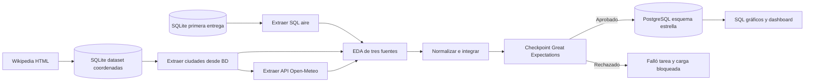
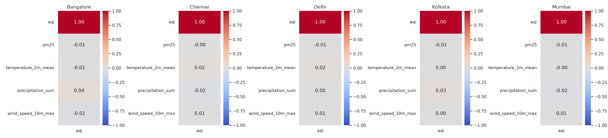

[Abrir notebook en Colab](https://colab.research.google.com/github/santbce/etl-calidad-aire-india-segunda-entrega/blob/main/notebooks/Segunda_entrega_India_Colab.ipynb)

# Calidad del aire y clima en India segunda entrega

Samuel Flores y Santiago Becerra. Curso ETL G51.

Continuamos el proyecto de la primera entrega sobre AQI y contaminantes en Bangalore, Chennai, Delhi, Kolkata y Mumbai. El objetivo refinado es describir cómo se relacionan temperatura, precipitación y viento con AQI y PM2.5 por ciudad y periodo, conservando las 18.265 mediciones de 2015–2024. Las relaciones son exploratorias, no causales. La relación temática se mantiene con ODS 3 y ODS 11.

## Abrir en Colab

Abre `Segunda_entrega_India_Colab.ipynb` en Google Colab. Ejecuta las celdas en orden. Carga el ZIP original `etl-calidad-aire-india-main.zip` o léelo desde la carpeta `second delivery` en tu Drive. El notebook incluye el código completo y genera los archivos de este repositorio. No requiere Docker.

Se usa un entorno aislado de Python 3.12 con Airflow 2.11.2 y los constraints oficiales, siguiendo `airflow_intro.ipynb` y `airflow_gx.ipynb` del profesor. GX utiliza el mismo patrón Suite → Data Source → Asset → Batch Definition → Validation Definition → Checkpoint de S8. Se fijó GX 1.24.0 para poder reproducir las pruebas; no se afirma que esta fuera la versión instalada por el profesor.

Colab instala PostgreSQL dentro de la sesión Linux. La primera entrega y las coordenadas siguen en SQLite como fuentes. El warehouse final está en PostgreSQL, de acuerdo con el stack solicitado en la segunda entrega. Se crea un esquema dedicado `india_dw`; ninguna tarea escribe en la base original.

## Fuentes

1. Primera entrega: `primera_entrega/database/air_quality.db`, procedente de Kaggle [AQI Air Quality Data India 2015–2024](https://www.kaggle.com/datasets/sathvikisikella/cleaned-air-quality-india). Se extraen desde SQL solo identificadores, ciudad, fecha, categoría y contaminantes del periodo requerido.
2. Dataset adicional: coordenadas de las cinco páginas de ciudades en Wikipedia. Se extrae la coordenada principal del artículo usando `requests` y `BeautifulSoup`, se conserva el HTML y se carga en `data/cities.sqlite`. La tarea del DAG extrae desde la tabla `city_coordinates`. Aporta cinco registros y se relaciona muchos a uno con las mediciones. Este es un dataset geográfico pequeño, no una segunda serie de mediciones.
3. API pública: [Historical Weather API de Open-Meteo](https://open-meteo.com/en/docs/historical-weather-api), endpoint `https://archive-api.open-meteo.com/v1/archive`. Consultas ciudad/año, modelo ERA5, zona `Asia/Kolkata`, temperatura media diaria en °C, precipitación diaria en mm y viento máximo diario a 10 m en m/s. Se conservan coordenadas solicitadas y coordenadas de la celda devueltas. La fuente es reanálisis, no una estación meteorológica específica. La caché guarda parámetros, URL, JSON y fecha UTC de extracción. Se reutiliza hasta 24 horas, de forma explícita en la procedencia.

## Requisitos y preguntas

- Comparar AQI por ciudad y evolución anual/mensual.
- Explorar las asociaciones de AQI y PM2.5 con las tres variables del clima por ciudad; evitar confundir diferencias entre ciudades con una asociación global.
- Conservar las 18.265 combinaciones ciudad/día, sin duplicar ni descartar registros válidos.
- Bloquear publicación ante nulos, claves duplicadas, fechas fuera del periodo, valores negativos o falta de coincidencia meteorológica.
- Obtener gráficos únicamente desde filas aprobadas y cargadas en PostgreSQL.

## Arquitectura y DAG

El DAG `etl_calidad_aire_india_enriquecido` usa `with DAG`, `PythonOperator` y dependencias `>>`, igual que los ejemplos de clase. Se programa cada día, con `catchup=False` y `max_active_runs=1`. La primera extracción y las coordenadas pueden ejecutarse independientemente. La API espera las coordenadas. EDA, merge, validación, carga y visualización siguen en ese orden.

Se detiene la tarea de validación con una excepción si falla el checkpoint. La regla por defecto `all_success` impide ejecutar carga y visualización. Se escogió este flujo en vez del branching de demostración porque aquí la carga es real y un lote inválido debe dejar la ejecución fallida. No se sustituyen las tareas de carga por comandos `echo`.

## EDA y decisiones de transformación

El notebook genera tipos, nulos, duplicados de fila y de clave, frecuencias, estadísticas, IQR e histogramas para las tres fuentes antes de publicar. Los resultados se guardan por ejecución en `data/runs/<run_id>/eda_sources.json`. El notebook muestra estas tablas y exige interpretarlas antes de entregar.

Se convierte la fecha a ISO y las medidas a numérico. Las claves de ciudad provienen de la base original. Se unen coordenadas por `city_id` con `validate='many_to_one'` y clima por `city_id,date` con `validate='one_to_one'`, conservando todas las filas con `left join`. Los registros sin clima se documentan y detienen el lote. No se imputan datos meteorológicos, no se convierten nulos en cero ni se eliminan outliers solo por IQR. No se inventan unidades de contaminantes que el dataset no documenta.

Las fechas originales se interpretan como días locales de India. Es una hipótesis explícita porque la fuente no documenta la zona horaria; requiere revisión con la documentación del dataset antes de interpretar asociaciones diarias como equivalentes exactas. La categoría AQI se conserva; no se recalcula con umbrales de otra escala.

## Contrato de calidad

La suite implementa conteo exacto, campos obligatorios no nulos, identificador único, unicidad compuesta ciudad/fecha, ciudades y categorías permitidas, fechas del periodo, rangos geográficos, contaminantes/AQI/lluvia/viento no negativos y un rango físico amplio de temperatura. Un control adicional compara el conjunto completo de las cinco ciudades y los 3.653 días esperados.

Se guardan `expectation_suite.json`, `validation.json` y una aprobación con SHA-256 del CSV validado. La carga verifica que el lote no haya cambiado desde la aprobación. Una validación anterior no habilita un archivo modificado. Los JSON contienen el resultado real de GX, no una aprobación escrita manualmente.

## Modelo de datos y carga

Grano: una medición por ciudad y día. `fact_air_quality` mantiene mediciones originales y clima. Las dimensiones son `dim_city` (coordenadas y procedencia), `dim_date` (día/calendario) y `dim_aqi` (categorías). La vista `air_quality_enriched` reconstruye el dataset enriquecido. `etl_runs` registra la ejecución y su validación.

PostgreSQL aplica PK, FK, UNIQUE y CHECK. Se reemplaza el lote dentro de una sola transacción: fallos revierten la carga, reejecutar no acumula mediciones. Es una instantánea histórica, no una carga incremental de datos actuales. La programación diaria renueva la extracción y comprueba el lote, sin afirmar que el CSV histórico crece.

## Resultados y evidencias

Las figuras y el dashboard se generan leyendo únicamente `india_dw.air_quality_enriched` tras la carga. Incluyen promedio de AQI por ciudad, distribuciones del clima, evolución anual y correlaciones por ciudad. `findings.json`, `monthly.csv` y `correlations_by_city.csv` permiten comprobar cifras. No se deben escribir conclusiones sobre clima antes de ejecutar esa parte.

Para evidenciar la orquestación, el notebook ejecuta `airflow dags test` y consulta `dag_run` y `task_instance` en la base de metadatos. Después permite iniciar scheduler/webserver para observar el DAG. La prueba deliberada introduce precipitación negativa en un lote separado: GX debe rechazarlo y el lote del warehouse debe conservarse. El notebook descarga el código, reportes y un dump PostgreSQL al terminar.

## Colab y entrega

Airflow puede programar ejecuciones mientras el runtime de Colab permanece activo. Colab no garantiza un servicio diario permanente y al terminar la sesión pueden desaparecer el entorno y las bases. Por eso se exportan resultados y dump al Drive. Para operación continua futura habría que alojar el mismo DAG en un servidor persistente; Docker no es necesario para esta práctica.

Antes de entregar: ejecutar el notebook completo en Colab, revisar los resultados y completar la interpretación del EDA, guardar evidencia de estados de tareas y fallo deliberado, confirmar con el profesor la fecha indicada en clase y publicar desde la cuenta del equipo en GitHub. La existencia de una URL en el README original no prueba que esta segunda entrega esté publicada. No se ha publicado ni enviado nada al profesor automáticamente.

## Correspondencia con los materiales de clase

| Material | Uso en la implementación |
|---|---|
| S6 Extracción y notebooks | SQLite, consulta SQL, `requests`, `BeautifulSoup`, JSON, timeout, Retry y merge |
| ingesta_multiple_practica | contratos de entrada, cardinalidad, procedencia y fallo deliberado |
| Airflow airflow_intro | Python 3.12 aislado, Airflow 2.11.2, PythonOperator, DAG, `dags test` |
| Airflow airflow_retries | distinguir fallos temporales de contrato |
| S8 gx y airflow_gx | suite, asset, lote, ValidationDefinition, checkpoint y bloqueo de carga |

Se revisaron las diapositivas y el código de prácticas. Las grabaciones MP4 no se transcribieron; no se atribuyen decisiones verbales al profesor.

## Referencias

- Consigna proporcionada: Project Second delivery, cinco páginas.
- Propuesta del equipo: Diseño de extracción y orquestación para la calidad del aire en India.
- [Documentación de Open-Meteo](https://open-meteo.com/en/docs/historical-weather-api).
- [DAGs de Apache Airflow](https://airflow.apache.org/docs/apache-airflow/2.11.0/core-concepts/dags.html).
- [GX Data Context](https://docs.greatexpectations.io/docs/core/set_up_a_gx_environment/create_a_data_context/).

## Estructura

`primera_entrega/`: copia sin cambios del proyecto anterior. `src/`: funciones Python. `dags/`: orquestación. `sql/`: DDL PostgreSQL. `data/`: fuentes adicionales, caché y lotes. `reports/`: dashboard y hallazgos desde warehouse. `notebooks/`: notebook Colab. `tests/`: pruebas de protección de carga.

## Ejecucion verificada

El DAG completo termino con nueve tareas exitosas. Se validaron 18.265 mediciones, la carga invalida quedo bloqueada y se comprobo idempotencia. Ver [informe de resultados](docs/resultados_ejecucion.md), [diagramas](docs/diagramas.md), [comprobaciones](evidencias/comprobaciones.json) y [estados de Airflow](evidencias/airflow_task_states.csv). El ZIP de la primera entrega esta en data para reproducir la ejecucion.

