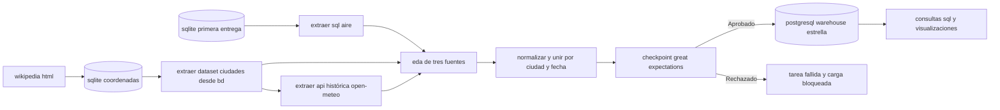
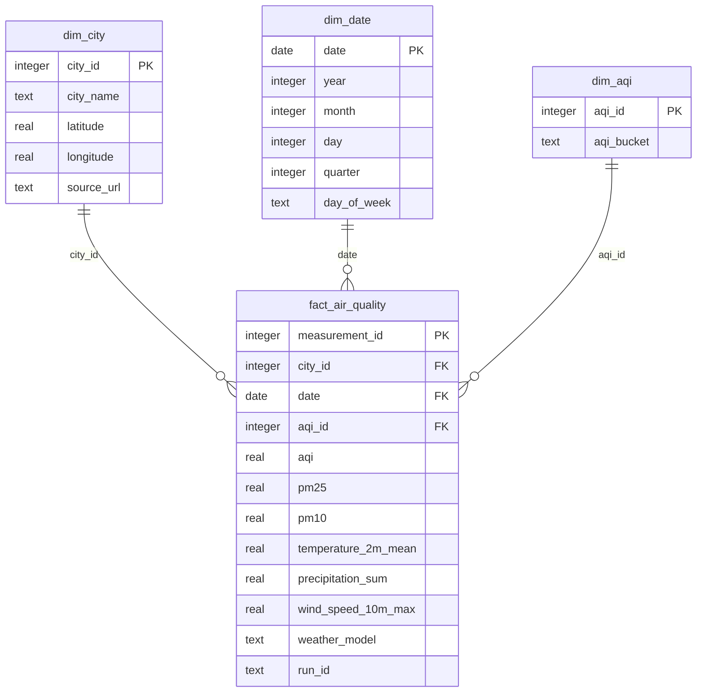

#aqui mostramos los diagramas de la segunda entrega

#aqui mostramos la arquitectura

#aqui mostramos el modelo estrella

grano: una medicion por ciudad y dia. el ddl completo esta en `sql/warehouse.sql`; el diagrama destaca las medidas principales.

